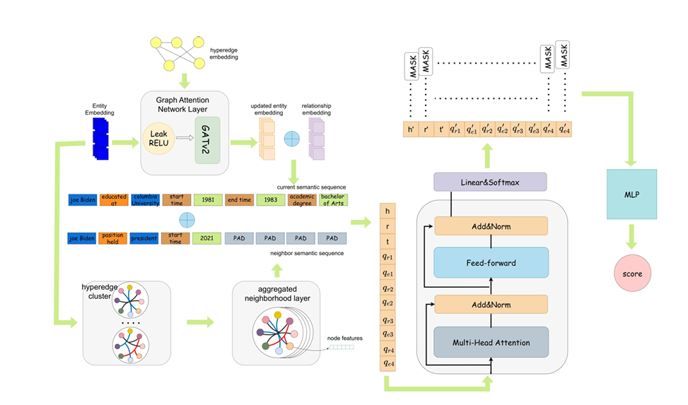

# HKNI

Official resources of **"HKNI: Fusing Neighbor Information for Hyper-Relational Knowledge Graph Completion"**. Peng Chen, Shuang Liu, Daqing Liu, Jingwei Li, Liangyang Xu, Simon Kolmanic. **Scientific reports 2026**.

## Overview
The Fusing Neighbor Information for Hyper-Relational Knowledge Graph Completion (HKNI) model
for link prediction on hyper-relational knowledge graphs:


## Introduction

This is the implementation of HKNI, a hyper-relational knowledge graph completion model that
incorporates neighbor information. HKNI not only effectively handles the two types of
representations within hyper-relations (hypergraph-based graph representations and
semantic-based sequential representations), but also efficiently processes neighbor
information.

This repository contains the code and data, as well as the optimal configurations to reproduce
the reported results.

## Requirements and Installation
This project should work fine with the following environments:
- Python 3.8.13 for data preprocessing, training and evaluation with:
    -  torch 1.10.0+cu113
    -  torch-scatter 2.0.9
    -  torch-sparse 0.6.13
    -  torch-cluster 1.6.0
    -  torch-geometric 2.1.0.post1
    -  numpy 1.23.3
- GPU with CUDA 11.3

All the experiments are conducted on a single GeForce GTX 4090 Ti GPU.

#### Setup with Conda

```
bash env.sh
```

## How to Run

### Step 1. Download raw data
We consider two commonly used hyper-relational datasets, and the datasets can be downloaded from:
- [JF17K](https://www.dropbox.com/sh/ryxohj363ujqhvq/AAAoGzAElmNnhXrWEj16UiUga?dl=0)
- [WikiPeople](https://github.com/gsp2014/WikiPeople)

WikiPeople is derived from the human-related facts of Wikidata, with the textual statements
removed. JF17K is a subset of the classic Freebase dataset. The data statistics of these two
datasets are shown below.

| Dataset | Train | Valid | Test | Entity | Relation | H-Fact | MaxArity |
| ------- | ----- | ----- | ---- | ------ | -------- | ------ | -------- |
| WikiPeople | 294439 | 37715 | 37712 | 34839 | 178 | 69866 | 7 |
| JF17K | 76379 | -- | 24568 | 28645 | 501 | 100947 | 6 |

> Note: JF17K is the only one that provides no dev set.

### Step 2. Preprocess data
Then we convert the raw data into the required format for training and evaluation. The new data
is organized into a directory named `data`, with a sub-directory for each dataset. In general, a
sub-directory contains:
- `train.json`: train set
- `valid.json`: dev set
- `train+valid.json`: train set + dev set
- `test.json`: test set
- `all.json`: combination of train/dev/test sets, used only for *filtered* evaluation
- `vocab.txt`: vocabulary consisting of entities, relations, and special tokens like [MASK] and [PAD]

### Step 3. Training & Evaluation

To train and evaluate the HKNI model, please run:

```
python -u ./src/run.py --name [TEST_NAME] --device [GPU_ID] --vocab_size [VOCAB_SIZE] --vocab_file [VOCAB_FILE] \
                       --train_file [TRAIN_FILE] --test_file [TEST_FILE] --ground_truth_file [GROUND_TRUTH_FILE] \
                       --num_workers [NUM_WORKERS] --num_relations [NUM_RELATIONS] \
                       --max_seq_len [MAX_SEQ_LEN] --max_arity [MAX_ARITY]
```

Here `[TEST_NAME]` is the unique name identifying one Training & Evaluation, `[GPU_ID]` is the GPU
ID you want to use.
`[VOCAB_SIZE]` is the number of vocab of the dataset.
`[VOCAB_FILE]` & `[TRAIN_FILE]` & `[TEST_FILE]` & `[GROUND_TRUTH_FILE]` are the paths storing the
vocab file("vocab.txt"), train file("train.json"), test file("test.json") and ground truth
file("all.json").
`[NUM_WORKERS]` is the number of workers when reading the data.
`[NUM_RELATIONS]` is the number of relations of the dataset.
`[MAX_ARITY]` is the maximum arity of N-arys in the datast, `[MAX_SEQ_LEN]` is the maximum length
of N-ary sequences, which is equal to (2 * [MAX_ARITY] - 1).

Please modify those hyperparametes according to your needs and characteristics of different
datasets.

The best hyperparameter settings for the two datasets are:

| Hyperparameter | WikiPeople | JF17K |
| -------------- | ---------- | ----- |
| epochs | 300 | 300 |
| Learning rate | 5e-4 | 5e-4 |
| Embedding dimension | 256 | 256 |
| Graph_dropout | 0.1 | 0.2 |
| Graph attention heads | 4 | 4 |
| Semantic_dropout | 0.1 | 0.2 |
| HGNN_activate | elu | elu |
| Decoder activate | gelu | gelu |
| Hidden size | 256 | 256 |
| Batch size | 1024 | 1024 |
| Weight decay | 0.01 | 0.01 |
| Soft label for entity | 0.2 | 0.9 |
| Soft label for relation | 0.1 | 0.0 |

For WikiPeople, to train and evalute on this dataset using its best hyperparametes, please run:

```
python -u ./src/run.py --dataset "wikipeople" --device "0" --vocab_size 35005 --vocab_file "./data/wikipeople/vocab.txt" \
                       --train_file "./data/wikipeople/train+valid.json" --test_file "./data/wikipeople/test.json" \
                       --ground_truth_file "./data/wikipeople/all.json" --num_workers 1 --num_relations 178 \
                       --max_seq_len 13 --max_arity 7 --hidden_dim 256 --global_layers 2 \
                       --global_dropout 0.1 --global_activation "elu" --global_heads 4 --local_layers 12\
                       --local_dropout 0.1 --local_heads 4 --decoder_activation "gelu" --batch_size 1024 \
                       --lr 5e-4 --weight_deca 0.01 --entity_soft 0.2 --relation_soft 0.1 \
                       --hyperedge_dropout 0.99 --epoch 300 --warmup_proportion 0.1
```

For JF17K, to train and evalute on this dataset using its best hyperparametes, please run:

```
python -u ./src/run.py --dataset "jf17k" --device "0" --vocab_size 29148 --vocab_file "./data/jf17k/vocab.txt" \
                       --train_file "./data/jf17k/train.json" --test_file "./data/jf17k/test.json" \
                       --ground_truth_file "./data/jf17k/all.json" --num_workers 1 --num_relations 501 \
                       --max_seq_len 11 --max_arity 6 --hidden_dim 256 --global_layers 2 \
                       --global_dropout 0.2 --global_activation "elu" --global_heads 4 --local_layers 12\
                       --local_dropout 0.2 --local_heads 4 --decoder_activation "gelu" --batch_size 1024 \
                       --lr 5e-4 --weight_deca 0.01 --entity_soft 0.9 --relation_soft 0.0 \
                       --hyperedge_dropout 0.85 --epoch 300 --warmup_proportion 0.05
```

## Evaluation Metrics
We use the following two commonly used performance metrics for knowledge graph representation
learning: Mean Reciprocal Rank (MRR) and Hits@n, which measures the average percentage of
instances with rank smaller than n. Typically, we set n={1, 3, 10}.

## BibTex

If you find this work is helpful for your research, please cite:

```bibtex
@inproceedings{chen2026hkni,
    title = "{HKNI}: Fusing Neighbor Information for Hyper-Relational Knowledge Graph Completion",
    author = "Chen, Peng  and
      Liu, Shuang  and
      Liu, Daqing  and
      Li, Jingwei  and
      Xu, Liangyang  and
      Kolmanic, Simon",
    booktitle = "Scientific Reports",
    month = December,
    year = "2026",
    address = "Dalian, China",
    publisher = "Springer Nature",
    doi = "",
    abstract = "The hyper-relation knowledge graph constructed by hyper-relation facts can effectively express most of the information in the real world. Similar to traditional knowledge graphs, it inevitably suffers from missing information, which makes link prediction on hyper-relational knowledge graphs equally important. Owing to the extension from binary relations to n-ary relations, however, hyper-relational knowledge graphs involve both hypergraph-based graph representations and semantic-based sequential representations. Most existing models mainly focus on handling only one type of representation within the internal structure of hyper-relations, which limits comprehensive learning of hyper-relational knowledge graphs. Moreover, hyper-relational knowledge graphs contain abundant neighbor information, yet most existing models simply feed the sequential representations into Transformer layers, which severely limits their ability to exploit such neighbors. To address these two issues, this paper presents a hyper-relational knowledge graph completion model that integrates neighbor information (HKNI). HKNI not only effectively handles the two types of representations within hyper-relations, but also efficiently processes neighbor information. Finally, we compare our model with existing baselines, and the experimental results demonstrate that our model achieves the best performance on link prediction tasks.",
}
```

For further questions, please contact: chenpeng@neusoft.edu.cn (Peng Chen) or liushuang@dlnu.edu.cn (Shuang Liu, corresponding author).
